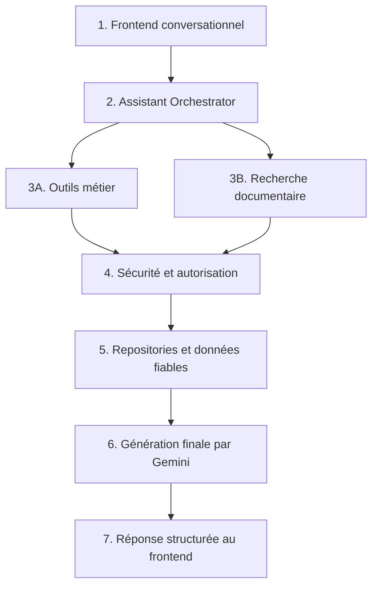
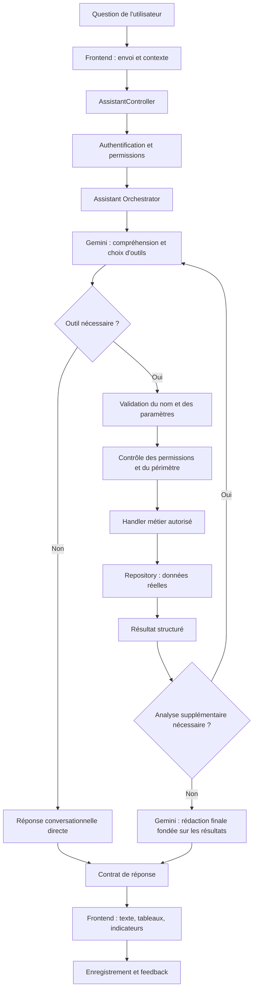

# Réflexion senior : faire de l’assistant de ton application scolaire une véritable IA

Ton objectif est plus ambitieux que d’ajouter quelques réponses prédéfinies à l’assistant.

Tu veux qu’un utilisateur puisse poser une question naturellement, comme à Gemini :

- « Combien d’élèves sont inscrits cette année ? »
- « Quels élèves n’ont pas encore payé les frais du premier trimestre ? »
- « Pourquoi le montant des frais de cette classe est-il différent de celui de l’année passée ? »
- « Fais-moi un résumé des absences de cette semaine. »
- « Explique-moi comment consulter les résultats d’un élève. »
- « Reformule ce rapport dans un langage professionnel. »
- « Compare les résultats de deux classes et explique les différences. »

Et tu veux que l’assistant **comprenne la question, trouve les données auxquelles l’utilisateur a réellement droit, les analyse, puis formule une réponse naturelle, claire et intelligente**.

C’est la bonne direction. Mais il faut distinguer deux capacités :

1. **La capacité de connaître et d’accéder aux données de l’application.**
2. **La capacité de comprendre ces données et de les expliquer comme une IA conversationnelle.**

Un assistant peut avoir Gemini derrière lui et rester médiocre si son backend ne lui donne accès qu’à cinq commandes prédéfinies. Inversement, un assistant peut avoir accès à beaucoup de données, mais répondre dangereusement s’il ne respecte pas les permissions ou s’il invente des chiffres.

La solution n’est donc pas simplement de changer le modèle IA. Il faut concevoir un véritable système d’assistance autour du modèle.

## 1. Comment les grandes applications construisent leurs assistants

J’ai recherché les architectures utilisées pour les assistants modernes et comparé ces principes au code actuel de ton application.

Les systèmes les plus sérieux ne reposent pas sur un simple appel au modèle avec une question. Ils combinent plusieurs composants : un modèle de langage, des outils métier, un moteur de récupération des informations, une couche de sécurité, un mécanisme de suivi de conversation et une étape de génération de réponse finale.

### A. Le modèle comprend la demande, mais ne possède pas directement la base de données

Dans les architectures modernes, le modèle peut décider qu’il doit appeler une fonction pour récupérer des informations. Il ne fait pas lui-même la requête métier : l’application exécute la fonction, vérifie les droits, renvoie les résultats au modèle, puis celui-ci rédige une réponse fondée sur ces résultats.

C’est le principe du *function calling* ou de l’utilisation d’outils.

Le fonctionnement idéal pour ton application serait :

1. L’utilisateur pose sa question en français naturel.
2. L’IA comprend l’intention, le contexte et les informations recherchées.
3. Elle choisit les outils métier nécessaires.
4. Le backend vérifie les permissions et les limites d’accès.
5. Les repositories récupèrent les données réelles de la base.
6. L’IA reçoit les résultats structurés.
7. Elle peut effectuer une seconde étape d’analyse si nécessaire.
8. Elle rédige une réponse naturelle, contextualisée et utile.
9. Le frontend affiche la réponse, les données et éventuellement un tableau ou un graphique.

**La différence essentielle :** le modèle ne doit pas seulement classer la question. Il doit aussi pouvoir travailler à partir du résultat métier pour produire une réponse intelligente.

### B. Les assistants modernes utilisent plusieurs outils, pas une liste infinie de questions prédéfinies

Un assistant d’entreprise peut disposer d’outils comme :

- rechercher un élève ;
- consulter les inscriptions ;
- compter les effectifs ;
- consulter les paiements ;
- calculer les soldes ;
- analyser les absences ;
- consulter les résultats ;
- comparer les années scolaires ;
- rechercher dans les documents de l’établissement ;
- expliquer une procédure administrative.

L’IA choisit les outils appropriés selon la demande. Les outils sont indépendants du modèle : on peut améliorer ou remplacer un outil métier sans réécrire toute l’intelligence conversationnelle.

Les architectures d’agents documentées par Google Cloud insistent également sur la séparation entre orchestration, récupération de données, outils et gouvernance.

### C. Les données structurées et les documents ne se récupèrent pas de la même manière

C’est un point particulièrement important pour ton application scolaire.

| Type de question | Mécanisme approprié |
|---|---|
| Combien d’élèves sont inscrits ? | Requête SQL métier |
| Qui n’a pas payé ? | Requête métier + calcul serveur |
| Quelle classe a le meilleur résultat ? | Agrégation et classement côté PHP/SQL |
| Que signifie une règle de l’école ? | Recherche documentaire |
| Explique-moi cette statistique | Données SQL + génération IA |
| Compare deux périodes | Plusieurs outils métier + analyse IA |
| Comment faire une inscription ? | Base de connaissances + réponse IA |

Les architectures RAG (*Retrieval-Augmented Generation*) récupèrent les passages pertinents d’une base documentaire, puis les transmettent au modèle pour qu’il formule une réponse fondée sur ces documents.

Pour ton application, je recommande donc **deux moteurs de récupération complémentaires** :

- un moteur de données scolaires structurées, basé sur les repositories ;
- un moteur de recherche documentaire, pour les règlements, procédures, guides et explications.

Il ne faut pas utiliser une base vectorielle pour remplacer les requêtes SQL sur les paiements ou les notes. Les données financières et scolaires doivent rester calculées par le backend.

## 2. Ce que j’ai réellement observé dans ton application

J’ai relu les principaux fichiers de l’assistant sur la branche `main` de ton dépôt GitHub.

Voici les composants qui existent déjà :

| Composant | Fichier | Responsabilité actuelle |
|---|---|---|
| Contrôleur | `AssistantController.php` | Reçoit la question et orchestre le traitement |
| Fournisseur IA | `GeminiService.php` | Envoie la question à Gemini |
| Catalogue d’intentions | `AssistantIntentCatalog.php` | Décrit les domaines que l’IA peut comprendre |
| Registre de capacités | `AssistantCapabilityRegistry.php` | Décrit les fonctions métier disponibles |
| Normalisation | `AssistantParameterNormalizer.php` | Résout les classes, années et périodes |
| Contrat d’exécution | `AssistantExecutionContract.php` | Valide la classification |
| Exécuteur métier | `AssistantBusinessExecutor.php` | Appelle les opérations métier |
| Repository | `AssistantRepository.php` | Récupère les données dans la base |
| Rédacteur | `AssistantResponseWriter.php` | Formule les réponses à partir des résultats |
| Contrat d’affichage | `AssistantDisplayContract.php` | Prépare les tableaux et les données affichables |
| Frontend | `assistant.js` | Gère la conversation et affiche les résultats |

Tu as donc déjà posé plusieurs fondations importantes : un fournisseur IA séparé, un catalogue, des capacités métier, une normalisation, un repository et une interface de conversation.

Ce n’est pas un assistant entièrement dépourvu d’architecture. Le problème est plutôt que **l’architecture actuelle ne permet pas encore à Gemini d’exploiter toute la puissance conversationnelle que tu recherches**.

### Le problème principal : Gemini est surtout utilisé comme classificateur

Dans `GeminiService.php`, le modèle reçoit le catalogue des intentions autorisées et doit retourner un objet structuré contenant notamment :

- l’intention ;
- la capacité ;
- les paramètres ;
- la nécessité éventuelle de demander une précision.

C’est utile pour comprendre une question. Mais ce n’est pas encore le fonctionnement complet d’un assistant de type Gemini.

Le modèle est actuellement sollicité principalement pour déterminer :

> « Quelle fonction PHP dois-je utiliser pour cette question ? »

Alors que tu veux qu’il puisse également répondre :

> « Maintenant que j’ai les données, que signifient-elles, comment les expliquer et quelle réponse utile puis-je donner à l’utilisateur ? »

Cette deuxième étape est le changement le plus important à introduire.

### Deuxième constat : le contrôleur contient encore beaucoup de logique de compréhension

Dans `AssistantController.php`, après la classification, on trouve de nombreuses expressions régulières qui recherchent des mots comme :

- paiements ;
- absences ;
- résultats ;
- élèves ;
- classes ;
- matières ;
- parents.

Le contrôleur tente ensuite de corriger ou de compléter la décision de Gemini.

Cela crée une double logique :

- Gemini interprète la question ;
- PHP réinterprète une partie de la question.

Cette approche peut être utile comme mécanisme de secours, mais elle devient fragile lorsqu’on ajoute des demandes complexes.

Par exemple :

> « Compare les absences non justifiées de la sixième année avec celles de l’année précédente, puis explique si la situation s’est améliorée. »

Cette demande contient plusieurs opérations :

1. comprendre le domaine des absences ;
2. identifier deux périodes ;
3. récupérer deux ensembles de données ;
4. calculer la différence ;
5. interpréter le résultat ;
6. rédiger une conclusion.

Une série d’expressions régulières ne constitue pas un moteur fiable pour gérer toute cette logique.

### Troisième constat : les réponses sont encore trop prédéfinies

Dans `AssistantResponseWriter.php`, les réponses sont principalement construites avec des modèles de phrases PHP.

Par exemple, une synthèse des paiements est formulée à partir des montants attendus, payés et restants.

C’est correct pour garantir des chiffres fiables. Mais cela ne permet pas à l’assistant de reformuler librement, d’expliquer les résultats ou d’adapter son discours au contexte de la question.

**C’est pourquoi l’assistant peut parfois donner une réponse correcte, mais qui ressemble davantage à un rapport automatique qu’à une conversation avec une IA.**

### Quatrième constat : les capacités métier sont encore limitées

Le registre `AssistantCapabilityRegistry.php` définit plusieurs capacités utiles, et `AssistantBusinessExecutor.php` sait exécuter certaines opérations liées aux paiements, aux absences et aux résultats.

Cependant, il faut distinguer :

- une permission existante dans l’application ;
- une capacité métier réellement implémentée ;
- une capacité que l’assistant sait découvrir et utiliser ;
- une capacité dont le résultat peut être expliqué par l’IA.

Une permission `eleves.consulter` ne signifie pas automatiquement que l’assistant sait répondre à toutes les questions sur les élèves.

Il faut une fonction métier correspondante, un résultat structuré et un chemin d’exécution fiable.

## 3. L’architecture que je recommande pour ton application de gestion scolaire

Je recommande de faire évoluer l’assistant vers une architecture en **7 couches**, sans abandonner ton MVC personnalisé.



Cette architecture sépare clairement les responsabilités.

Le contrôleur ne doit pas connaître toutes les formulations possibles. Le modèle ne doit pas exécuter directement du SQL. Le repository ne doit pas rédiger des réponses conversationnelles. Et le frontend ne doit pas décider des permissions.

## 4. Le changement le plus important : passer de « classer puis répondre » à « comprendre, utiliser des outils, puis rédiger »

Voici le flux que je mettrais en place.



Google documente justement ce cycle : le modèle propose un appel de fonction, l’application exécute la fonction et transmet son résultat au modèle, qui peut ensuite produire la réponse finale.

### Exemple concret

L’utilisateur demande :

> « Dans quelle classe les paiements sont-ils les plus faibles cette année, et explique-moi pourquoi ? »

Le système ne doit pas chercher uniquement un mot comme « paiement ».

Il doit comprendre que la demande implique :

- l’année scolaire active ;
- une comparaison entre classes ;
- un indicateur de paiement ;
- une analyse des résultats ;
- une explication.

Le modèle peut alors demander plusieurs outils métier, par exemple :

```text
get_payment_summary_by_class(year_id)
get_payment_rate_by_class(year_id)
get_payment_trends(year_id, previous_year_id)
```

Ces noms sont des exemples de futures capacités, pas des fonctions que j’affirme déjà présentes dans ton dépôt.

Le backend exécute les outils, puis retourne des données structurées :

```json
{
  "school_year": "2026-2027",
  "classes": [
    {
      "class": "6e primaire",
      "expected": 120000,
      "paid": 72000,
      "remaining": 48000,
      "payment_rate": 60
    }
  ]
}
```

Gemini reçoit ensuite ce résultat et rédige une réponse comme :

> « La sixième année présente le taux de recouvrement le plus faible parmi les classes analysées, avec 60 % des frais attendus déjà payés. Il reste 48 000 à recouvrer. Pour expliquer cette situation, il faudrait examiner les échéances, le nombre d’élèves concernés et les tendances des paiements. Les données actuelles montrent le niveau de recouvrement, mais ne permettent pas à elles seules d’établir la cause des retards. »

Voilà la différence entre **un assistant qui affiche des chiffres et un assistant qui les comprend et les explique sans inventer**.

## 5. Comment rendre l’assistant capable de répondre à beaucoup plus de questions

Je ne recommande pas d’ajouter des dizaines de regex supplémentaires. Je recommande de construire un **catalogue de capacités métier découvrables**.

Chaque capacité devrait posséder un contrat clair :

- nom unique ;
- description compréhensible par le modèle ;
- paramètres autorisés ;
- paramètres obligatoires ;
- permission nécessaire ;
- périmètre de données ;
- handler PHP ;
- format de résultat ;
- limites et règles métier.

Par exemple :

```text
Capacité : attendance.compare_periods

Description :
Comparer les absences entre deux périodes scolaires.

Paramètres :
- classe_id
- periode_1_debut
- periode_1_fin
- periode_2_debut
- periode_2_fin

Permission :
absences.consulter

Résultat :
- total_periode_1
- total_periode_2
- difference
- variation_percent
```

L’IA pourrait alors comprendre des formulations variées :

- « Compare les absences de ce mois à celles du mois passé. »
- « Est-ce que les absences ont augmenté ? »
- « Fais une comparaison entre les deux périodes. »
- « Quelle est l’évolution de l’assiduité ? »

Toutes ces formulations peuvent aboutir à la même capacité métier, sans devoir écrire une regex pour chacune.

### Les familles de capacités que je développerais

**Élèves et inscriptions**

Recherche, effectifs, inscriptions, changements de classe, répartition, dossiers autorisés.

**Paiements et frais**

Soldes, impayés, paiements partiels, recouvrement, comparaison des périodes, tendances.

**Présences et absences**

Synthèses, absences justifiées, tendances, comparaisons, élèves concernés.

**Notes et résultats**

Moyennes, classements officiels, réussite, évolution, comparaison des classes.

**Connaissances de l’école**

Règlement, procédures, calendrier, fonctionnement, documents et guides.

Le but est que l’assistant puisse **composer plusieurs capacités** pour répondre à une question complexe.

## 6. La sécurité : l’IA ne doit jamais décider seule de ce qu’un utilisateur peut voir

Tu as raison d’insister sur les permissions.

Pour un utilisateur X, l’assistant doit toujours respecter les mêmes règles que le reste de l’application.

La sécurité doit être appliquée à plusieurs niveaux :

1. Le contrôleur vérifie l’authentification.
2. Le catalogue ne propose que les capacités compatibles avec les permissions de l’utilisateur.
3. Chaque handler vérifie de nouveau la permission nécessaire.
4. Le repository limite les données au périmètre autorisé.
5. Les résultats sensibles sont filtrés avant d’être transmis au modèle.
6. La réponse finale ne doit pas révéler des informations absentes des résultats autorisés.

Il faut aussi distinguer les rôles. Un directeur, un enseignant, un comptable et un parent ne doivent pas nécessairement recevoir les mêmes données, même s’ils posent la même question.

**La permission ne doit pas être uniquement une permission globale : elle doit parfois être accompagnée d’un périmètre.**

Par exemple, un enseignant peut avoir le droit de consulter les résultats, mais uniquement ceux de ses classes. Un parent peut consulter les informations de ses propres enfants, et non celles de tous les élèves.

Enfin, une IA ne doit jamais pouvoir :

- inventer une permission ;
- fournir directement une requête SQL à exécuter ;
- modifier les frais ou les notes sans procédure métier ;
- confirmer une opération financière sans validation ;
- exécuter une action destructive simplement parce que le modèle l’a suggérée.

OWASP souligne que les injections de prompt et les sorties imprévues du modèle deviennent particulièrement dangereuses lorsque l’agent dispose de fonctions trop puissantes ou de permissions excessives.

Pour ton assistant, je privilégierais d’abord **les capacités de lecture et d’analyse**. Les actions d’écriture viendront plus tard, avec confirmation explicite et audit.

## 7. Le frontend : il doit devenir une véritable interface conversationnelle

Actuellement, ton frontend dispose déjà d’un historique, d’une zone de saisie, de suggestions et de l’affichage de résultats structurés.

Je conserverais cette base, mais je ferais évoluer l’expérience.

### A. Afficher une vraie réponse, pas seulement une phrase technique

La réponse devrait être composée de plusieurs éléments :

- une introduction naturelle ;
- une réponse directe ;
- les chiffres importants ;
- un tableau si nécessaire ;
- une explication ou une interprétation ;
- les filtres utilisés ;
- la période et l’année scolaire ;
- une indication de la source des données.

Par exemple, au lieu de :

> « 25 élèves avec un solde restant. »

L’assistant pourrait afficher :

> « J’ai trouvé 25 élèves ayant encore un solde à payer dans la classe et la période demandées. Le tableau ci-dessous présente leur situation. Les montants proviennent des données de paiement enregistrées dans l’application. »

Puis afficher le tableau.

### B. Ajouter le streaming

L’utilisateur ne devrait pas attendre que toute la réponse soit terminée sans retour visuel.

Le frontend pourrait afficher :

- « Je comprends votre question… »
- « Je consulte les données… »
- « J’analyse les résultats… »
- puis la réponse progressivement.

Gemini documente le streaming des interactions, y compris les appels d’outils et la génération finale.

Cela améliore fortement la sensation de fluidité, même si le temps réel dépend aussi de la base de données et du modèle.

### C. Gérer les questions de clarification intelligemment

Si l’utilisateur demande :

> « Compare les résultats. »

L’assistant ne doit pas répondre par un échec technique.

Il devrait demander :

> « Souhaitez-vous comparer les résultats de deux classes ou de deux périodes scolaires ? »

Et si le contexte de la conversation contient déjà la classe, il doit la réutiliser au lieu de demander de nouveau.

### D. Rendre les résultats interactifs

Le frontend pourrait proposer :

- « Afficher les détails »
- « Comparer avec l’année précédente »
- « Expliquer ce résultat »
- « Télécharger le rapport »
- « Reformuler en rapport professionnel »

Ces actions doivent envoyer une nouvelle demande structurée à l’assistant, avec le contexte nécessaire.

### E. Sécuriser le rendu des réponses

J’ai observé dans `assistant.js` que les messages sont construits avec `innerHTML`, avec une fonction d’échappement utilisée sur plusieurs données.

Il faut conserver une politique stricte :

- échapper les textes utilisateur ;
- échapper les textes venant du modèle ;
- ne pas afficher directement du HTML généré par Gemini ;
- si Markdown est pris en charge, le convertir avec un renderer sécurisé et une sanitation adaptée ;
- ne jamais exécuter de script contenu dans une réponse.

La réponse de l’IA doit être considérée comme une donnée non fiable, même si elle provient de ton propre fournisseur.

## 8. Backend : comment faire évoluer ton MVC sans le casser

Je ne te conseille pas de remplacer tout l’`AssistantController.php` d’un seul coup.

Je procéderais par extraction progressive, en conservant les routes et les contrats de réponse existants.

### Structure cible

```text
src/
├── controllers/
│   └── AssistantController.php
│
├── services/
│   ├── AssistantOrchestrator.php
│   ├── AssistantConversationService.php
│   ├── AssistantToolRegistry.php
│   ├── AssistantToolExecutor.php
│   ├── AssistantAnswerGenerator.php
│   ├── AssistantContextBuilder.php
│   ├── AssistantAuthorizationService.php
│   ├── AssistantResponseValidator.php
│   ├── AssistantEvaluationService.php
│   └── ...
│
├── repositories/
│   ├── AssistantRepository.php
│   ├── StudentRepository.php
│   ├── PaymentRepository.php
│   ├── AttendanceRepository.php
│   └── ResultRepository.php
│
└── ...
```

Cette structure est une proposition d’évolution. Elle ne signifie pas que tous ces fichiers existent déjà.

### Responsabilités

**AssistantController**

Il reçoit la requête HTTP, vérifie les protections nécessaires, appelle l’orchestrateur et retourne la réponse.

**AssistantOrchestrator**

Il gère le cycle conversationnel : comprendre, choisir un outil, exécuter, recevoir le résultat, décider si une autre étape est nécessaire.

**AssistantToolRegistry**

Il expose au modèle les outils disponibles pour cet utilisateur, selon ses droits.

**AssistantToolExecutor**

Il valide les paramètres, appelle le handler correspondant et contrôle les limites d’exécution.

**AssistantAnswerGenerator**

Il reçoit les résultats métier et demande à Gemini de produire une réponse naturelle, sans inventer de données.

**Repositories**

Ils restent responsables de la récupération et des calculs de données. Les requêtes SQL doivent rester paramétrées.

**AssistantResponseValidator**

Il vérifie que la réponse finale respecte le contrat attendu avant de l’envoyer au frontend.

## 9. La mémoire conversationnelle : faire en sorte que l’assistant se souvienne du contexte utile

Ton `AssistantRepository.php` possède déjà un mécanisme de récupération du contexte récent de conversation.

C’est une bonne base, mais il faut faire évoluer la gestion du contexte.

Exemple :

**Utilisateur :** « Combien d’élèves sont dans la sixième ? »

**Assistant :** « La sixième compte 42 élèves. »

**Utilisateur :** « Et combien ont payé ? »

L’assistant doit comprendre que « la sixième » est toujours le filtre actif.

Il ne doit pas demander à nouveau la classe.

Je recommande de conserver un contexte conversationnel structuré :

```json
{
  "active_school_year_id": 12,
  "active_class_id": 6,
  "active_period_id": null,
  "last_domain": "payments",
  "last_tool": "payments.summary"
}
```

Ce contexte doit être stocké côté serveur et associé à la conversation de l’utilisateur.

Il faut également distinguer :

- l’historique des messages ;
- les paramètres actifs de la conversation ;
- les résultats précédemment récupérés ;
- les informations personnelles ou sensibles qui ne doivent pas être conservées inutilement.

Le modèle doit pouvoir réutiliser le contexte, mais le backend doit toujours revalider les permissions à chaque nouvelle demande.

## 10. Comment atteindre réellement une couverture proche de 99 %

Je veux être précis sur ce point : **aucun développeur sérieux ne peut garantir que l’assistant répondra correctement à 99 % de toutes les questions imaginables.**

Mais on peut viser un taux très élevé sur un ensemble défini de questions scolaires, en construisant une stratégie de tests et d’amélioration continue.

Je recommande de créer un jeu d’évaluation interne.

### Exemple de catégories de tests

| Catégorie | Exemples |
|---|---|
| Questions simples | Effectif, nombre de classes, liste d’élèves |
| Questions avec filtres | Classe, année scolaire, trimestre |
| Questions conversationnelles | « Et pour la classe suivante ? » |
| Questions complexes | Comparer deux périodes |
| Questions multi-domaines | Paiements + absences + résultats |
| Questions ambiguës | « Montre-moi les meilleurs » |
| Questions hors périmètre | Sujet non pris en charge |
| Questions interdites | Données d’un utilisateur non autorisé |
| Questions adversariales | Prompt injection, demandes de SQL |
| Questions de reformulation | Résumer, expliquer, rédiger un rapport |

Pour chaque test, il faut vérifier :

- l’intention détectée ;
- les outils sélectionnés ;
- les paramètres ;
- la permission appliquée ;
- la fiabilité des données ;
- la qualité de la réponse ;
- l’absence d’invention ;
- le comportement en cas d’erreur.

### Les métriques à suivre

Je mesurerais séparément :

- taux de compréhension correcte ;
- taux de sélection correcte des outils ;
- taux de paramètres corrects ;
- taux de récupération des bonnes données ;
- taux de réponse finale fidèle aux résultats ;
- taux de refus correct pour les demandes interdites ;
- taux de clarification appropriée ;
- taux de réponse complète sur les questions prises en charge.

Il faut éviter de mélanger ces métriques dans un seul score. Une réponse peut être bien formulée mais contenir des chiffres incorrects.

Le vrai objectif devrait être :

> **99 % de fiabilité sur les scénarios métier validés, et une gestion honnête des questions non prises en charge.**

L’assistant doit savoir dire :

> « Je n’ai pas trouvé les données nécessaires pour répondre avec certitude. »

Cela vaut mieux qu’une réponse inventée.

## 11. Le plan de travail que je recommande

Je ne commencerais pas par une refonte graphique ni par un changement de modèle. Je suivrais cet ordre.

- **Phase A — Audit complet du flux actuel**  
  Cartographier toutes les intentions, capacités, permissions, handlers, repositories et formats de réponse. Identifier les capacités réellement exécutables et les domaines encore incomplets.

- **Phase B — Stabiliser les contrats**  
  Définir un contrat unique entre Gemini, les outils métier, les résultats et le frontend. Éliminer les divergences entre classification et réinterprétation regex, progressivement.

- **Phase C — Introduire l’orchestrateur**  
  Permettre à l’assistant d’appeler un ou plusieurs outils, de recevoir les résultats et de poursuivre son raisonnement opérationnel jusqu’à la réponse finale.

- **Phase D — Ajouter la génération finale**  
  Gemini reçoit les résultats vérifiés et rédige une réponse naturelle, avec un prompt qui interdit l’invention de chiffres ou de faits absents des résultats.

- **Phase E — Élargir les capacités métier**  
  Développer les outils manquants dans les domaines scolaires, avec permissions et tests dédiés.

- **Phase F — Ajouter la recherche documentaire**  
  Indexer les règlements, procédures et guides de l’école pour répondre aux questions de connaissance.

- **Phase G — Améliorer le frontend**  
  Streaming, affichage conversationnel, tableaux, sources, clarification, actions de suivi et gestion des erreurs.

- **Phase H — Évaluation et optimisation**  
  Constituer un corpus de questions réelles, mesurer les erreurs, corriger les outils et améliorer les prompts à partir des résultats.

## Ma conclusion de senior

Ton assistant possède déjà une base intéressante : Gemini, un catalogue d’intentions, un registre de capacités, un exécuteur métier, des repositories, une mémoire de conversation et une interface.

Mais il est encore trop proche d’un **assistant de classification avec des réponses PHP prédéfinies**.

La transformation que je recommande est la suivante :

**Gemini comprend et planifie. Le backend autorise et exécute. Les repositories fournissent les faits. Gemini analyse et rédige. Le frontend présente une réponse complète et interactive.**

C’est cette séparation qui permettra d’élargir progressivement les questions auxquelles l’assistant peut répondre, sans sacrifier la sécurité ni la fiabilité des données scolaires.

Et je garderais une règle fondamentale pour toute la suite du développement :

> L’assistant ne doit pas être capable de répondre à tout en inventant. Il doit être capable de rechercher tout ce que ses outils autorisés peuvent réellement fournir, d’expliquer ce qu’il a trouvé, et de reconnaître clairement ce qu’il ne sait pas encore.

La prochaine étape utile serait de transformer cette réflexion en **audit technique détaillé du flux actuel, capacité par capacité**, puis de préparer une première évolution de l’orchestrateur sans casser les routes ni les fonctionnalités déjà en place.
